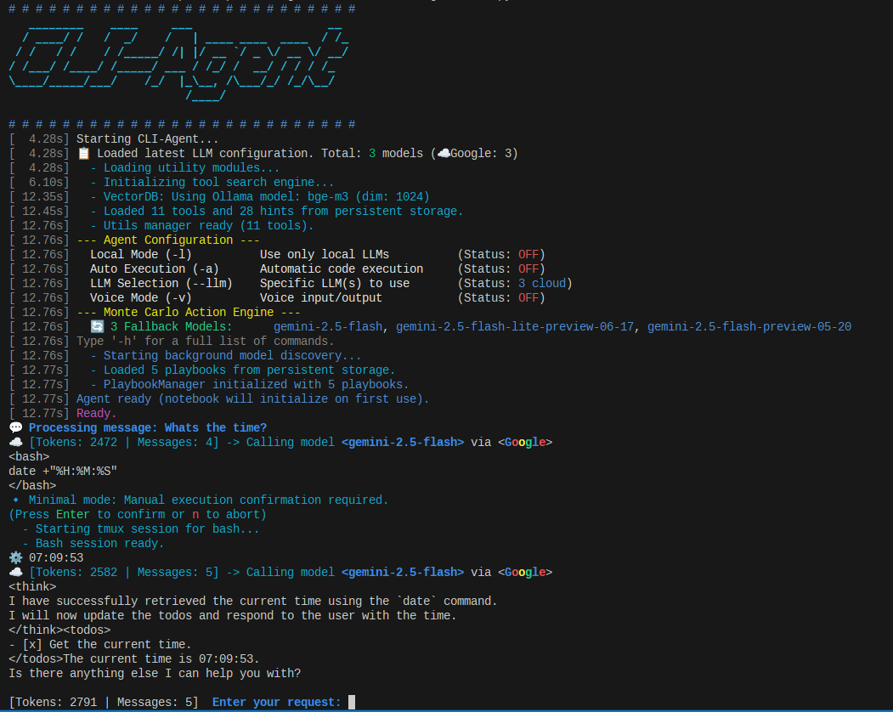
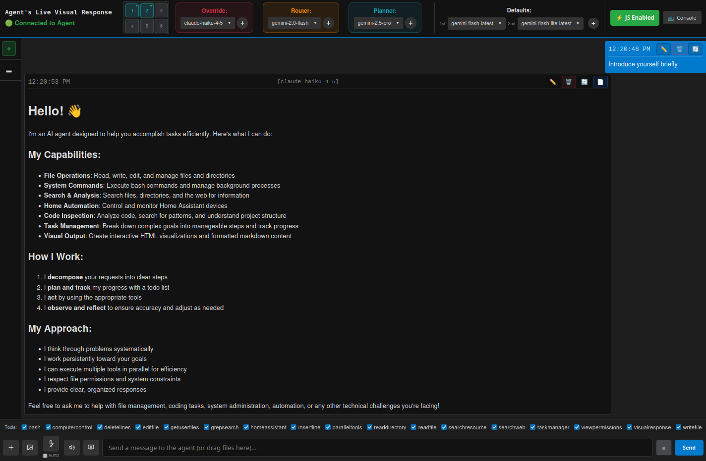

# CLI-Agent

A powerful command-line AI agent framework for autonomous task execution and coding assistance.

# CLI Interface


# Web Interface


## Overview

CLI-Agent is an AI agent framework that provides:
- Multi-provider LLM support (OpenAI, Anthropic, Google Gemini, Groq, Ollama)
- Interactive web interface with real-time visualization
- Smart tool discovery using vector database
- Docker isolation for secure execution
- Path-aware permission system
- Audio processing with speech recognition and TTS

## Features

- **Multi-LLM Support**: Seamlessly switch between AI providers (OpenAI, Anthropic, Google, Groq, Ollama)
- **Smart Tool Management**: Vector-based tool discovery and context-aware suggestions
- **Interactive Permissions**: Path-aware permission system with persistent rules
- **Web Interface**: Real-time browser-based UI with multiple tabs support
- **Docker Isolation**: Secure containerized execution (`--isolated` mode)
- **Audio Integration**: Speech recognition and TTS support
- **Centralized Storage**: Per-project chat isolation in `~/.cli-agent/projects/` with auto-migration
- **Comprehensive Testing**: Full test suite with hierarchical test levels

## Deployment Options

### 1. Local Development (Single User)
```bash
python main.py              # CLI mode
python main.py --gui        # Web interface
python main.py --api        # API server only
```

### 2. Isolated Mode (Docker - Single Run) 🆕
Run in a fully isolated Docker container with a single flag:

```bash
# First run (builds cached image, ~2-3 min)
python main.py --isolated

# Subsequent runs (instant start, ~2-5 sec)
python main.py --isolated -m "Your message here"
python main.py --isolated --gui  # Web interface in container
```

**Benefits**: Full isolation, no dependency conflicts, auto-syncs latest code
**See:** [Isolated Mode Docs](docker_files/docs/ISOLATED_MODE.md) for details.

## Installation

1. Clone the repository:
```bash
git clone <repository-url>
cd CLI-Agent
```

2. Install system dependencies:
```bash
sudo apt-get update
sudo apt-get install -y python3-pip python3-dev python3-venv build-essential ffmpeg portaudio19-dev libsndfile1
```

3. Create and activate virtual environment:
```bash
python3 -m venv .venv
source .venv/bin/activate
```

4. Install Python dependencies:
```bash
pip install --upgrade pip
pip install -r requirements.txt
pip install -e core/
pip install -e shared/
```

5. Set up environment variables:
```bash
cp .env.example .env
# Edit .env with your API keys
```

## Usage

### Basic Usage
```bash
python main.py
```

### Running Tests
```bash
python run_tests.py --quick
python run_tests.py --full
```

## Architecture

### Single-User Architecture

- `core/`: Core AI infrastructure (LLM routing, chat, providers)
- `shared/`: Shared utilities (audio, web, search, RAG)
- `tools/`: Individual tool implementations (file operations, search, etc.)
- `api/`: Backend API layer (WebSocket, REST endpoints)
- `frontend/`: Web UI assets (HTML, CSS, JavaScript)
- `tests/`: Comprehensive test suite including tool testing framework
- `docs/`: Documentation and architecture guides

## Configuration

The agent uses environment variables for configuration:
- `ANTHROPIC_API_KEY`: Anthropic/Claude API key
- `OPENAI_API_KEY`: OpenAI API key
- `GOOGLE_API_KEY`: Google Gemini API key
- `GROQ_API_KEY`: Groq API key
- `BRAVE_API_KEY`: Brave Search API key

## Contributing

1. Run tests: `python run_tests.py`
2. Check code formatting: `ruff format .`
3. Run linting: `ruff check .`

## License

This project is licensed under the MIT License.