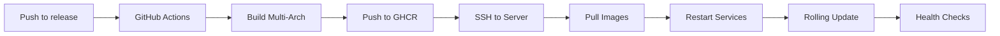

# CLI-Agent Multi-User Deployment Guide

> **⚠️ EXPERIMENTAL - NOT PRODUCTION READY**
>
> This multi-user infrastructure is currently **EXPERIMENTAL** and has not been fully tested in production.
> - Last containers active: ~4 weeks ago
> - Requires significant testing before production deployment
> - See [INFRASTRUCTURE_STATUS.md](INFRASTRUCTURE_STATUS.md) for current status
>
> **For production deployments**, consider using:
> - `python main.py --isolated` for single-user containerized deployment ([ISOLATED_MODE.md](ISOLATED_MODE.md))
> - Single-user mode behind reverse proxy for simpler multi-user setups
>
> Only proceed if you need true multi-tenant SaaS architecture and are prepared to test extensively.

**Version:** 1.0.0
**Last Updated:** 2025-10-12

This guide covers deploying CLI-Agent's multi-user architecture to production servers.

---

## Table of Contents

1. [Prerequisites](#prerequisites)
2. [Initial Setup](#initial-setup)
3. [Building Images](#building-images)
4. [Deploying Infrastructure](#deploying-infrastructure)
5. [Testing Deployment](#testing-deployment)
6. [Production Configuration](#production-configuration)
7. [Monitoring](#monitoring)
8. [Maintenance](#maintenance)
9. [Backup & Recovery](#backup--recovery)
10. [Troubleshooting](#troubleshooting)

---

## Prerequisites

### System Requirements

**Minimum:**
- 4 CPU cores
- 8GB RAM
- 50GB disk space
- Ubuntu 22.04 LTS (or similar)

**Recommended:**
- 8+ CPU cores
- 16GB+ RAM
- 200GB+ SSD storage
- Ubuntu 22.04 LTS

### Software Requirements

```bash
# Docker (version 24.0+)
curl -fsSL https://get.docker.com -o get-docker.sh
sudo sh get-docker.sh

# Docker Compose (version 2.20+)
sudo apt-get install docker-compose-plugin

# Verify installations
docker --version
docker compose version

# Add user to docker group (logout/login required)
sudo usermod -aG docker $USER
```

### Network Requirements

- **Ports to expose:**
  - `80` - HTTP (Traefik)
  - `443` - HTTPS (Traefik, optional)
  - `8080` - Traefik Dashboard (restrict in production)

- **Firewall rules:**
```bash
sudo ufw allow 80/tcp
sudo ufw allow 443/tcp
# Only allow 8080 from trusted IPs
sudo ufw allow from 192.168.1.0/24 to any port 8080
```

---

## Initial Setup

### 1. Clone Repository

```bash
git clone https://github.com/your-org/CLI-Agent.git
cd CLI-Agent
```

### 2. Configure Environment

```bash
# Copy example environment file
cp .env.example .env

# Edit with your API keys
nano .env
```

**Required environment variables:**

```bash
# LLM Provider API Keys (at least one required)
ANTHROPIC_API_KEY=sk-ant-...
OPENAI_API_KEY=sk-...
GOOGLE_API_KEY=...
GROQ_API_KEY=gsk_...

# Optional: Web Search
BRAVE_API_KEY=...

# Container Manager Configuration (optional)
STORAGE_THRESHOLD=90
DEFAULT_RETENTION_DAYS=7
```

### 3. Review Configuration

```bash
# Check docker-compose configuration
cat docker_files/docker-compose.infrastructure.yml

# Check Traefik configuration
cat docker_files/traefik/traefik.yml
cat docker_files/traefik/dynamic.yml
```

---

## Building Images

### Automated Build

```bash
# Build all images (Container Manager, Backend, Frontend)
./scripts/build_all.sh
```

### Manual Build

```bash
# Build Container Manager
docker build \
  -f docker_files/Dockerfile.container-manager \
  -t cli-agent-manager:latest \
  .

# Build Backend
docker build \
  -f docker_files/Dockerfile.backend \
  -t cli-agent-backend:latest \
  .

# Build Frontend
docker build \
  -f docker_files/Dockerfile.frontend \
  -t cli-agent-frontend:latest \
  .
```

### Verify Images

```bash
# List built images
docker images | grep cli-agent

# Expected output:
# cli-agent-manager    latest    ...
# cli-agent-backend    latest    ...
# cli-agent-frontend   latest    ...
```

---

## Deploying Infrastructure

### Automated Deployment

```bash
# Deploy all services
./scripts/deploy.sh
```

This script will:
1. Build all Docker images
2. Create Docker network
3. Start infrastructure services
4. Wait for services to be ready
5. Perform health checks

### Manual Deployment

```bash
# Create network
docker network create cli-agent-network

# Start services
docker-compose -f docker_files/docker-compose.infrastructure.yml up -d

# Check service status
docker-compose -f docker_files/docker-compose.infrastructure.yml ps

# Expected output:
# cli-agent-traefik              running
# cli-agent-container-manager    running
# cli-agent-frontend             running
```

### Verify Deployment

```bash
# Check Traefik
curl -f http://localhost:8080/api/http/routers
echo "Traefik: $?"

# Check Container Manager
curl -f http://localhost/api/manager/health
echo "Container Manager: $?"

# Check Frontend
curl -f http://localhost/
echo "Frontend: $?"

# All should return 0 for success
```

---

## Testing Deployment

### Automated Testing

```bash
# Run comprehensive tests
./scripts/test_multi_user.sh
```

This script tests:
1. Infrastructure health checks
2. UUID-based container discovery
3. Container isolation
4. Docker resource creation
5. Cleanup functionality

### Manual Testing

#### Test 1: Frontend Access

```bash
# Open in browser
firefox http://localhost

# Or test with curl
curl -I http://localhost
# Should return: HTTP/1.1 200 OK
```

#### Test 2: Container Discovery

```bash
# Generate test UUID
UUID=$(uuidgen | tr '[:upper:]' '[:lower:]')
echo "Test UUID: $UUID"

# Discover container
curl -v http://localhost/api/manager/discover \
  -H "X-User-UUID: $UUID"

# Should return container info with status: success
```

#### Test 3: WebSocket Connection

```bash
# Install wscat if needed
npm install -g wscat

# Connect to WebSocket
wscat -c "ws://localhost/api/backend/$UUID/ws"

# Should connect successfully
```

#### Test 4: Container List

```bash
# List all active containers
curl http://localhost/api/manager/containers | jq .

# Should show count > 0 and container details
```

---

## Production Configuration

### TLS/HTTPS Setup

#### 1. Enable Let's Encrypt in Traefik

Edit `docker_files/traefik/traefik.yml`:

```yaml
# Uncomment certificatesResolvers section
certificatesResolvers:
  letsencrypt:
    acme:
      email: admin@yourdomain.com  # Change this
      storage: /letsencrypt/acme.json
      httpChallenge:
        entryPoint: web
```

#### 2. Enable HTTPS Redirect

Edit `docker_files/traefik/traefik.yml`:

```yaml
entryPoints:
  web:
    address: ":80"
    http:
      redirections:
        entryPoint:
          to: websecure
          scheme: https
```

#### 3. Update Security Headers

Edit `docker_files/traefik/dynamic.yml`:

```yaml
security-headers:
  headers:
    sslRedirect: true  # Change from false
```

#### 4. Restart Services

```bash
docker-compose -f docker_files/docker-compose.infrastructure.yml restart
```

### Securing Traefik Dashboard

#### Option 1: Disable Publicly

Edit `docker_files/traefik/traefik.yml`:

```yaml
api:
  dashboard: true
  insecure: false  # Change from true
```

#### Option 2: Add Basic Auth

```bash
# Generate password hash
htpasswd -nb admin yourpassword

# Add to docker_files/traefik/dynamic.yml:
http:
  middlewares:
    dashboard-auth:
      basicAuth:
        users:
          - "admin:$apr1$..."  # Output from htpasswd

  routers:
    dashboard:
      middlewares:
        - dashboard-auth
```

### Resource Limits

Edit `docker_files/docker-compose.infrastructure.yml`:

```yaml
services:
  container-manager:
    deploy:
      resources:
        limits:
          memory: 2G      # Increase if needed
          cpus: '2.0'     # Increase if needed
```

### Adjust Cleanup Intervals

Edit `api/container_manager.py`:

```python
# Production settings
async def cleanup_loop():
    await asyncio.sleep(1800)  # 30 minutes (from 3600)

async def cpu_adjustment_loop():
    await asyncio.sleep(600)   # 10 minutes (from 900)

async def storage_monitoring_loop():
    await asyncio.sleep(300)   # 5 minutes (from 600)
```

### Container Retention

```python
# In api/container_manager.py
DEFAULT_RETENTION_DAYS = 14  # Increase from 7

# Or set via environment variable in docker-compose
environment:
  - DEFAULT_RETENTION_DAYS=14
```

---

## Monitoring

### Service Health

```bash
# Check all services
docker-compose -f docker_files/docker-compose.infrastructure.yml ps

# Check Container Manager health
curl http://localhost/api/manager/health | jq .

# Check active backend containers
curl http://localhost/api/manager/containers | jq '.containers | length'
```

### Logs

```bash
# View all logs
docker-compose -f docker_files/docker-compose.infrastructure.yml logs -f

# View specific service
docker logs -f cli-agent-container-manager
docker logs -f cli-agent-traefik
docker logs -f cli-agent-frontend

# View backend container logs
docker logs -f cli-agent-{uuid_short}

# Tail last 100 lines
docker logs --tail 100 cli-agent-container-manager
```

### Resource Usage

```bash
# Overall Docker stats
docker stats

# Container-specific stats
docker stats cli-agent-container-manager cli-agent-traefik cli-agent-frontend

# Disk usage
docker system df

# Volume usage
docker volume ls | wc -l
docker volume ls --filter "label=cli-agent.managed=true" | wc -l
```

### Storage Monitoring

```bash
# Check disk space
df -h

# Check Container Manager logs for storage alerts
docker logs cli-agent-container-manager 2>&1 | grep -i storage

# Check cleanup events
docker logs cli-agent-container-manager 2>&1 | grep -i cleanup
```

---

## Maintenance

### Updating Images

```bash
# Rebuild images
./scripts/build_all.sh

# Stop services
docker-compose -f docker_files/docker-compose.infrastructure.yml down

# Start with new images
docker-compose -f docker_files/docker-compose.infrastructure.yml up -d

# Verify update
docker images | grep cli-agent
```

### Database Maintenance

```bash
# Backup Container Manager database
docker exec cli-agent-container-manager cp /data/container_manager.db /data/container_manager.db.backup

# Copy to host
docker cp cli-agent-container-manager:/data/container_manager.db.backup ./backups/

# Restore database
docker cp ./backups/container_manager.db.backup cli-agent-container-manager:/data/container_manager.db
docker-compose -f docker_files/docker-compose.infrastructure.yml restart container-manager
```

### Log Rotation

```bash
# Configure Docker log rotation
# Edit /etc/docker/daemon.json:
{
  "log-driver": "json-file",
  "log-opts": {
    "max-size": "10m",
    "max-file": "3"
  }
}

# Restart Docker
sudo systemctl restart docker

# Restart services
docker-compose -f docker_files/docker-compose.infrastructure.yml up -d
```

### Pruning Unused Resources

```bash
# Remove stopped containers
docker container prune -f

# Remove unused images
docker image prune -a -f

# Remove unused volumes (CAUTION: May remove user data)
docker volume prune -f

# Remove only orphaned volumes
docker volume ls --filter "dangling=true" -q | xargs docker volume rm
```

---

## Backup & Recovery

### What to Backup

1. **Container Manager Database:** `/data/container_manager.db`
2. **Environment Variables:** `.env`
3. **Docker Compose Configuration:** `docker_files/docker-compose.infrastructure.yml`
4. **Traefik Configuration:** `docker_files/traefik/`
5. **User Volumes:** (optional) `cli-agent-{uuid_short}-*`

### Backup Script

```bash
#!/bin/bash
# backup.sh

BACKUP_DIR="./backups/$(date +%Y%m%d_%H%M%S)"
mkdir -p $BACKUP_DIR

# Backup Container Manager database
docker cp cli-agent-container-manager:/data/container_manager.db \
  $BACKUP_DIR/container_manager.db

# Backup configuration
cp .env $BACKUP_DIR/.env
cp -r docker_files $BACKUP_DIR/docker_files

# Backup user volumes (optional, can be large)
docker volume ls --filter "label=cli-agent.managed=true" --format "{{.Name}}" | \
  while read volume; do
    docker run --rm -v $volume:/data -v $BACKUP_DIR:/backup \
      alpine tar czf /backup/$volume.tar.gz -C /data .
  done

echo "Backup complete: $BACKUP_DIR"
```

### Recovery Procedure

```bash
# 1. Stop services
docker-compose -f docker_files/docker-compose.infrastructure.yml down

# 2. Restore database
docker volume create container-manager-data
docker run --rm -v container-manager-data:/data -v ./backups/latest:/backup \
  alpine cp /backup/container_manager.db /data/

# 3. Restore configuration
cp backups/latest/.env .env
cp -r backups/latest/docker_files docker_files

# 4. Restore volumes (if backed up)
for volume in backups/latest/*.tar.gz; do
  name=$(basename $volume .tar.gz)
  docker volume create $name
  docker run --rm -v $name:/data -v ./backups/latest:/backup \
    alpine tar xzf /backup/$name.tar.gz -C /data
done

# 5. Start services
docker-compose -f docker_files/docker-compose.infrastructure.yml up -d
```

---

## Troubleshooting

### Services Won't Start

```bash
# Check logs
docker-compose -f docker_files/docker-compose.infrastructure.yml logs

# Check ports
sudo netstat -tlnp | grep -E ':(80|443|8080)'

# Check Docker network
docker network inspect cli-agent-network

# Recreate network
docker network rm cli-agent-network
docker network create cli-agent-network
```

### Container Manager Can't Create Containers

```bash
# Check Docker socket permissions
ls -l /var/run/docker.sock

# Verify Container Manager has access
docker exec cli-agent-container-manager ls -l /var/run/docker.sock

# Check Container Manager logs
docker logs cli-agent-container-manager | grep -i error

# Check Docker disk space
docker system df
```

### Frontend Not Loading

```bash
# Check Nginx logs
docker logs cli-agent-frontend

# Check Nginx configuration
docker exec cli-agent-frontend nginx -t

# Check frontend files
docker exec cli-agent-frontend ls -la /usr/share/nginx/html

# Test directly
curl -v http://localhost/index.html
```

### WebSocket Connections Failing

```bash
# Check Container Manager WebSocket logs
docker logs cli-agent-container-manager | grep -i websocket

# Check Traefik routing
curl http://localhost:8080/api/http/routers | jq .

# Test WebSocket endpoint
wscat -c "ws://localhost/api/backend/{uuid}/ws"

# Check backend container
docker ps --filter "name=cli-agent-" --format "{{.Names}} {{.Status}}"
```

### High Resource Usage

```bash
# Identify resource hogs
docker stats --no-stream --format "table {{.Name}}\t{{.CPUPerc}}\t{{.MemUsage}}" | sort -k2 -hr

# Check number of backend containers
docker ps --filter "name=cli-agent-" --format "{{.Names}}" | wc -l

# Trigger manual cleanup
curl -X POST http://localhost/api/manager/cleanup

# Check storage
df -h
docker system df
```

---

## Appendix

### Environment Variables Reference

| Variable | Default | Description |
|----------|---------|-------------|
| `STORAGE_THRESHOLD` | 90 | Storage usage % to trigger aggressive cleanup |
| `DEFAULT_RETENTION_DAYS` | 7 | Days before container auto-cleanup |
| `ANTHROPIC_API_KEY` | - | Claude API key (required) |
| `OPENAI_API_KEY` | - | OpenAI API key (optional) |
| `GOOGLE_API_KEY` | - | Google Gemini API key (optional) |
| `GROQ_API_KEY` | - | Groq API key (optional) |
| `BRAVE_API_KEY` | - | Web search API key (optional) |

### Port Reference

| Port | Service | Purpose |
|------|---------|---------|
| 80 | Traefik | HTTP entry point |
| 443 | Traefik | HTTPS entry point |
| 8080 | Traefik | Dashboard (restrict in prod) |
| 7860 | Backend | Internal API port (not exposed) |
| Dynamic | Backend | Docker-assigned external port |

### Docker Label Reference

| Label | Example | Purpose |
|-------|---------|---------|
| `cli-agent.managed` | `true` | Identifies managed resources |
| `cli-agent.user-uuid` | `{uuid}` | Associates resource with user |
| `cli-agent.created` | `2025-10-12T...` | Creation timestamp |

---

---

## CI/CD Deployment

### GitHub Actions Workflows

CLI-Agent includes automated deployment workflows:

#### Production Deployment (`.github/workflows/deploy-production.yml`)
- **Trigger**: Push to `release` or `production` branch
- **Multi-arch builds**: linux/amd64 and linux/arm64
- **Registry**: GitHub Container Registry (ghcr.io)
- **Actions**:
  1. Build all images (backend, frontend, container-manager)
  2. Push to GHCR with tags: `latest`, `<branch>-<sha>`
  3. SSH to production server
  4. Pull images and tag locally
  5. Restart infrastructure services
  6. Rolling restart of backend containers
  7. Health check verification

#### Staging Deployment (`.github/workflows/deploy-staging.yml`)
- **Trigger**: Push to `main` or `develop` branch
- **Actions**:
  1. Run tests (`python run_tests.py --quick`)
  2. Run linters (ruff, black)
  3. Build staging images
  4. Deploy to staging server (if configured)

### GitHub Secrets Configuration

Navigate to **Settings → Secrets and variables → Actions** and add:

```bash
# Production Deployment
DEPLOY_HOST=<YOUR_SERVER_IP>          # Production server IP/hostname
DEPLOY_USER=<YOUR_USERNAME>                     # SSH username
DEPLOY_SSH_KEY=<private-key>        # SSH private key content
DEPLOY_PORT=22                       # SSH port (optional, default: 22)
DEPLOY_PATH=~/repos/CLI-Agent  # Deployment directory

# Staging Deployment (optional)
STAGING_HOST=<staging-ip>
STAGING_USER=<ssh-user>
STAGING_SSH_KEY=<private-key>
STAGING_PORT=22
STAGING_PATH=/opt/cli-agent-staging
```

### SSH Key Setup for CI/CD

```bash
# 1. Generate deployment key
ssh-keygen -t ed25519 -C "github-actions-deploy" -f ~/.ssh/cli-agent-deploy

# 2. Add public key to server
ssh-copy-id -i ~/.ssh/cli-agent-deploy.pub <YOUR_USERNAME>@<YOUR_SERVER_IP>

# 3. Copy private key to GitHub Secret
cat ~/.ssh/cli-agent-deploy
# Paste entire output into DEPLOY_SSH_KEY secret
```

### Deployment Workflow



### Manual Trigger

1. Go to **Actions** tab in GitHub
2. Select **Deploy to Production**
3. Click **Run workflow**
4. Select branch and confirm

### Container Update Strategy

**Problem**: Existing containers don't auto-update after image rebuild

**Solution**: Rolling restart
```bash
# Backend containers restart with cached old image
docker restart cli-agent-<uuid>

# To force new image, recreate:
docker rm -f cli-agent-<uuid>
# Container Manager auto-recreates with latest on next access
```

### Monitoring Deployments

```bash
# Check GitHub Actions logs
# Navigate to Actions tab → Select workflow run

# SSH to server and check
ssh <YOUR_USERNAME>@<YOUR_SERVER_IP>
docker ps --filter "name=cli-agent-"
docker logs cli-agent-container-manager

# Verify health
curl http://<YOUR_SERVER_IP>/api/manager/health
```

### Rollback Procedure

```bash
# SSH to server
ssh <YOUR_USERNAME>@<YOUR_SERVER_IP>

# Method 1: Git rollback
cd ~/repos/CLI-Agent
git log --oneline -n 5
git checkout <previous-commit>
./scripts/deploy.sh

# Method 2: Pull specific image version
docker pull ghcr.io/probst1nator/cli-agent_dev/cli-agent-backend:release-<sha>
docker tag ghcr.io/probst1nator/cli-agent_dev/cli-agent-backend:release-<sha> cli-agent-backend:latest
docker restart cli-agent-container-manager
# Restart other containers...
```

### Production Deployment Checklist

Before merging to `release`:

- [ ] Tests pass locally (`python run_tests.py --quick`)
- [ ] Code reviewed and approved
- [ ] Tested in staging environment
- [ ] GitHub Secrets configured
- [ ] SSH access to production server verified
- [ ] Backup created
- [ ] Monitoring/alerts ready
- [ ] Team notified

---

**For architecture details, see:** `docs/MULTI_USER_ARCHITECTURE.md`
**For CI/CD workflows, see:** `.github/workflows/`
